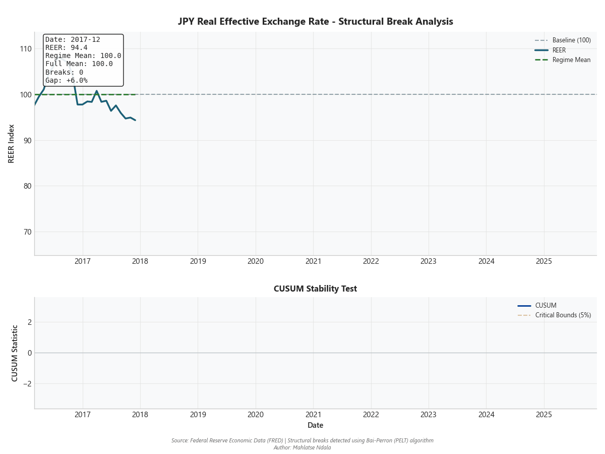

# The Hidden Regime Shift: Why Traditional Currency Valuation Models Are Misleading You

*A regime-adjusted approach to REER-based currency fair value*

---

## The JPY Puzzle

The Japanese yen is historically cheap. At a Real Effective Exchange Rate (REER) of 69, it trades 22% below its 10-year average of 88. By traditional valuation metrics, this screams "buy."

But here's the problem: that 10-year average includes a regime that no longer exists.

In January 2022, the yen underwent a structural break—a statistically significant shift in its equilibrium level. The Bank of Japan's ultra-loose policy divergence, combined with a global energy shock that hammered Japan's terms of trade, didn't just weaken the yen temporarily. It reset the baseline.

When I apply Bai-Perron structural break detection to the data, the post-2022 regime mean is **74**—not 88. Suddenly, the yen isn't 22% undervalued. It's closer to 7% cheap, and much of that gap is explained by carry differentials, not mispricing.

And the yen isn't an isolated case. When you plot each currency's REER as a percentage differential against the dollar, the divergence across the board is striking. As of December 2025, JPY trades **36% below** USD in real effective terms—the widest gap in the dataset. CNY sits **17% below**, INR **13% below**, and CAD **10% below**. On the other side, MXN trades **24% above** USD, while ZAR, AUD, and GBP cluster within a few percentage points of the dollar baseline.

[Flourish: REER Differentials vs USD (%)]
*Chart: Percentage REER differential vs USD over time — (REER(ccy) − REER(USD)) / REER(USD). Positive values indicate a currency trading above USD in real terms; negative values below.*

The chart makes one thing immediately visible: these gaps aren't stable. They widen, narrow, and sometimes invert entirely—suggesting the "equilibrium" everyone benchmarks against is itself a moving target.

**What if your valuation anchor is from a regime that no longer exists?**

This question should haunt every currency investor using simple historical averages as fair value benchmarks.

---

## The Problem with Static Averages

The standard approach to currency valuation goes something like this:

1. Calculate the 10-year rolling average of REER
2. Compare current REER to that average
3. If current < average → undervalued → expect appreciation
4. If current > average → overvalued → expect depreciation

This framework rests on a critical assumption: **REER is stationary and mean-reverting around a stable equilibrium.**

But currencies don't always revert to old means. Structural shifts create new equilibria:

- **BOJ yield curve control** (2016–2024) fundamentally repriced JPY carry dynamics
- **China's growth model rebalancing** shifted CNY from export-competitiveness to domestic consumption
- **US fiscal dominance** post-COVID reinforced the dollar's "exorbitant privilege"
- **EM current account adjustments** (Mexico's nearshoring boom, South Africa's energy crisis) reset local currency baselines

When these shifts occur, the old average becomes a **value trap anchor**. You're waiting for mean reversion to a mean that no longer applies.

---

## Detecting Regime Shifts: The Method

How do you know when a structural break has occurred? You could eyeball charts and make judgment calls—but that's subjective and non-reproducible.

Instead, I use the **Bai-Perron test**, implemented via the PELT (Pruned Exact Linear Time) algorithm. Here's the intuition:

1. The algorithm scans the time series for points where the statistical properties (mean, variance) change significantly
2. It penalizes adding too many breaks to avoid overfitting noise
3. The output is a set of breakpoint dates that segment the data into distinct regimes

**Key parameters:**
- **Penalty**: Higher values = fewer breaks (more conservative). I use 20 for developed markets, 10-15 for emerging markets with higher volatility
- **Minimum segment**: 24 months. Any regime shorter than 2 years is likely noise, not structure

Once breaks are detected, I calculate the **regime mean**—the average REER from the last breakpoint to today. This becomes my valuation anchor, replacing the naive 10-year average.

The insight is simple but powerful: **Use the post-break mean for valuation, not the full history.**


*Animation: CUSUM statistic and Bai-Perron break detection for JPY REER*

---

## What the Data Shows: 9 Major Currencies

I ran this analysis on G10 and major EM currencies. The results challenge conventional narratives:

| Currency | Current REER | Full 10Y Mean | Regime Mean | Adjustment | Implication |
|----------|--------------|---------------|-------------|------------|-------------|
| **JPY** | 69 | 88.2 | 74.0 | -14.2 | Not as cheap as headlines suggest |
| **USD** | 107 | 102.0 | 109.3 | +7.2 | Strong dollar is the "new normal" |
| **MXN** | 134 | 112.5 | 128.4 | +15.9 | Peso strength is structural, not a bubble |
| **ZAR** | 109 | 106.3 | 101.4 | -4.9 | Rand weakness is the new baseline |
| **GBP** | 111 | 103.6 | 110.2 | +6.6 | Post-Brexit premium now embedded |
| **CNY** | 89 | 97.1 | 90.7 | -6.5 | Weaker yuan regime since 2023 |
| **AUD** | 109 | 105.9 | 105.9 | 0.0 | No break detected—use full mean |
| **CAD** | 97 | 101.4 | 101.4 | 0.0 | No break detected |
| **INR** | 93 | 99.6 | 99.6 | 0.0 | No break detected |

### Key Takeaways by Currency:

**JPY (-14.2 adjustment):** The yen's weakness isn't a mispricing waiting to correct—it's a new equilibrium. The post-2022 regime reflects BOJ policy divergence and structural terms-of-trade deterioration. Valuation-driven JPY longs have been a painful trade for years.

**USD (+7.2 adjustment):** The dollar looks 5% overvalued vs its 10Y average, but fairly valued vs its post-2022 regime. US exceptionalism (growth, rates, safe haven) has repriced the equilibrium higher.

**MXN (+15.9 adjustment):** The peso's strength since late 2022 isn't a bubble—it's structural. Nearshoring tailwinds, high real rates, and remittance flows have shifted the equilibrium. Calling MXN "overvalued" based on the old mean is fighting the regime.

**ZAR (-4.9 adjustment):** The rand's weakness is now baked into the baseline. Load-shedding, fiscal deterioration, and current account deficits have reset fair value lower.

---

## Building the Full Return Framework

Valuation is only one component of expected currency returns. My framework combines three elements:

### 1. Real Carry (BEI-Adjusted)

Nominal yield differentials are misleading when inflation expectations differ. I use:

```
Real Carry = (Local Real Yield) - (USD Real Yield)
```

Where Real Yield = Nominal 10Y - Breakeven Inflation.

This captures the true purchasing-power-adjusted return from holding foreign bonds.

### 2. Regime-Adjusted Valuation Gap

```
Valuation Gap = (Regime Mean - Current REER) / Current REER
```

I assume 100% reversion over 10 years, so the annual valuation drag/boost is:

```
Valuation Annual = Valuation Gap / 10
```

Positive gap = undervalued = expected appreciation.

### 3. EM Structural Kicker (Balassa-Samuelson)

Emerging markets with productivity catch-up potential experience trend real appreciation. I add a small annual kicker (0.5-1.5%) for qualifying EMs based on growth differentials and structural reform momentum.

### Combined Formula:

```
Expected Annual Return = Real Carry + Valuation Annual + EM Kicker
```

This gives a disciplined, decomposed view of where returns come from—rather than a single "fair value" number with no mechanism.

---

## Actionable Takeaways for Practitioners

**1. Don't anchor to stale means.**
Before calling anything "cheap" or "expensive," test for structural breaks. A 10-year average that includes a dead regime is worse than useless—it's actively misleading.

**2. JPY caution is warranted.**
The undervaluation story is mostly priced in on a regime-adjusted basis. If you're long JPY for valuation, your thesis needs to be "regime shift back to pre-2022 norms"—which requires BOJ policy normalization *and* terms of trade recovery.

**3. MXN/ZAR divergence matters.**
These are both high-yielding EM currencies, but the regime story is opposite. Peso strength is structural; rand weakness is structural. Don't treat them as interchangeable "EM carry."

**4. USD resilience isn't overvaluation.**
The dollar's strength is consistent with its post-2022 regime. Shorting USD for valuation reasons is fighting the new equilibrium until you see evidence of a downward break.

**5. Framework over forecast.**
Use systematic regime detection, not discretionary chart-reading. The Bai-Perron method is reproducible and statistically grounded. Your valuation calls should be too.

---

## Closing: The Regime-Aware Investor

Markets don't revert to means that no longer exist.

Every major currency repricing—Plaza Accord, Asian Financial Crisis, Eurozone crisis, COVID—created new regimes. Investors who anchored to pre-crisis "fair values" waited years for reversions that never came.

Structural break detection isn't just an academic exercise. It's a practical tool for distinguishing **temporary dislocations** (which revert) from **permanent regime shifts** (which don't).

The next time you see a headline claiming a currency is "20% undervalued," ask the simple question:

*Undervalued relative to what regime?*

---

*All analysis uses FRED data for Real Effective Exchange Rates (monthly, BIS Broad index). Structural breaks detected using Bai-Perron (PELT algorithm) with 24-month minimum segment. Code available on request.*

*Author: Mahlatse Alex Ndala*
